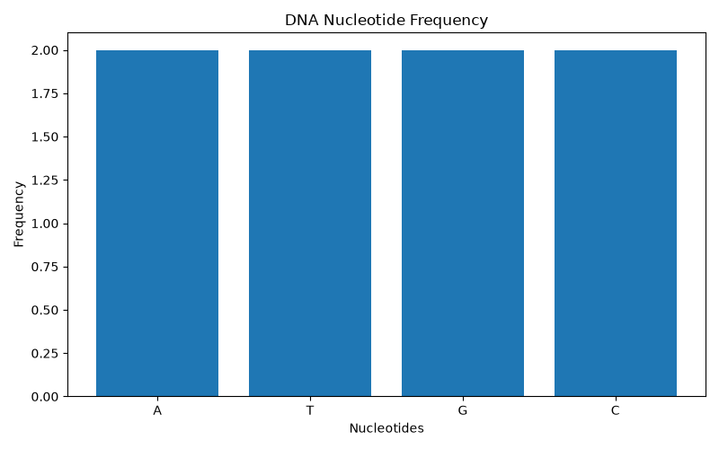

# DNA Sequence Analyzer

A Python-based bioinformatics project for analysing DNA sequences and exploring fundamental biological characteristics.

## Project Overview

This project aims to develop a computational tool that analyses DNA sequences and presents useful biological information through numerical summaries and visualisations.

## Objectives

- Calculate GC content.
- Determine nucleotide frequencies.
- Calculate DNA sequence length.
- Validate DNA sequences.
- Identify basic sequence patterns.
- Visualise sequence composition.

## Technologies

- Python
- Biopython
- Pandas
- Matplotlib

## Project Structure

The project will contain separate modules for sequence validation, analysis, visualisation and testing.

## Current Status

The analyzer computes nucleotide frequency and displays a visualisation

## Scientific Scope

This project is intended for educational and computational biology practice. It does not provide medical or diagnostic interpretations.

## Results

### Nucleotide Frequency

## Author
GitHub : patilkunalkp008-crypto

